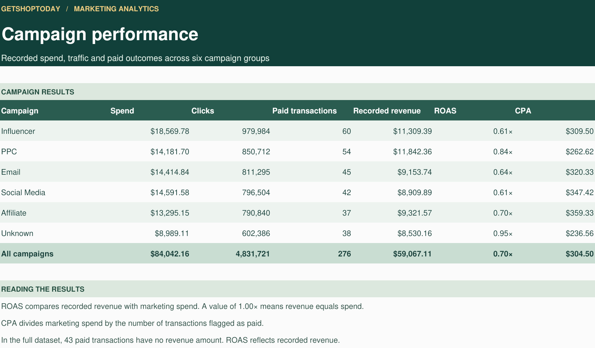

# GetShop Today — E-Commerce Marketing Analytics Dashboard

An Excel dashboard exploring marketing spend, campaign performance, customer conversions, and revenue across e-commerce channels.

**Tools:** Microsoft Excel · Pivot Tables · Slicers · Data Visualization

[View Excel Workbook](GetShop%20Today%20Customer%20Data%20%20Final%20project.xlsx) · [View Dataset](Datasets/GetShop%20Today%20Customer%20Data.csv) · [Explore the Analysis](#analysis-and-findings)

## Dashboard Preview

[View full-size dashboard](Images/dashboard_preview.png.jpeg)

## Project Overview

This project uses Microsoft Excel to examine marketing performance for GetShop Today, an e-commerce business. It brings campaign spend, traffic, conversions, and revenue into one dashboard to support comparisons across marketing channels.

The analysis covers Influencer, PPC, Email, Social Media, Affiliate, and Unknown campaign categories. Dashboard slicers allow users to explore results by product category, customer location, and referral source.

## Business Questions

- How is marketing spend distributed across campaign types?
- Which campaigns attract the most clicks?
- Which channels generate the most paid customers and revenue?
- How do cost per acquisition (CPA), cost per click (CPC), and click-through rate (CTR) compare across campaigns?

## Dashboard Metrics

The following figures reproduce the values displayed in the dashboard preview.

| Metric | Displayed value |
| --- | ---: |
| Total spend | $84K |
| Total clicks | 4,832K |
| Total conversions | 276 |
| Total revenue | $59K |
| Total ROI | $49.54 |
| Total CPA | $23K |

> **Metric interpretation:** K means thousand. The existing dashboard displays ROI as a currency value and CPA as a total. Their formulas, aggregation, and number formats should be reviewed before using these two figures to assess profitability or acquisition efficiency.

## Analysis and Findings

| Analysis area | What the dashboard compares | Finding visible in the preview |
| --- | --- | --- |
| Spend | Marketing spend and CPA by campaign | Influencer campaigns have the highest displayed spend, at approximately $19K. |
| Traffic | Clicks, CPC, and CTR by campaign | Influencer campaigns lead with approximately 980K clicks. |
| Conversions | Paid customers by campaign | Influencer campaigns record 60 paid customers, followed by PPC with 54. |
| Revenue | Revenue contribution by campaign | PPC has the highest displayed revenue, at approximately $12K, followed by Influencer at $11K. |

These comparisons identify channels for further investigation. Spend, customer acquisition, and revenue should be considered together when evaluating campaign performance.

## Tools and Techniques

- **Microsoft Excel:** data preparation, analysis, and dashboard development.
- **Pivot Tables:** campaign-level summaries and comparisons.
- **Charts and KPI cards:** visual presentation of marketing performance.
- **Slicers:** filtering by product category, customer location, and referral source.

## Repository Files

| File | Purpose |
| --- | --- |
| [Excel workbook](GetShop%20Today%20Customer%20Data%20%20Final%20project.xlsx) | Explore the analysis and interactive dashboard in Excel. |
| [CSV dataset](Datasets/GetShop%20Today%20Customer%20Data.csv) | Access the source data supplied with the project. |
| [Dashboard image](Images/dashboard_preview.png.jpeg) | View a static preview directly on GitHub. |

## How to Explore the Project

1. Start with the dashboard preview above for an overview.
2. Open the [Excel workbook page](GetShop%20Today%20Customer%20Data%20%20Final%20project.xlsx) and use GitHub's **Download raw file** button.
3. Open the downloaded workbook in Microsoft Excel.
4. Use the dashboard slicers to explore product categories, customer locations, and referral sources.
5. Review the [CSV dataset](Datasets/GetShop%20Today%20Customer%20Data.csv) to examine the underlying records.

The image on GitHub is a static preview; the dashboard's interactive controls are available in the Excel workbook.

## Skills Demonstrated

Marketing analytics · Data preparation · Pivot Table analysis · Dashboard design · Business insight communication

## Author

[Emmanuel F. Kebodi](https://github.com/emmyk77)
